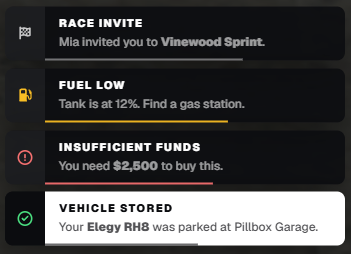
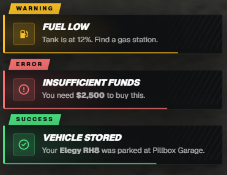
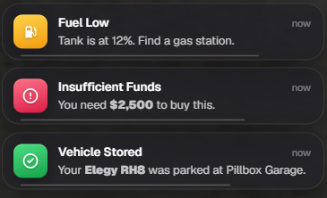
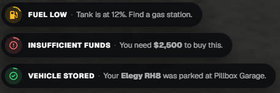
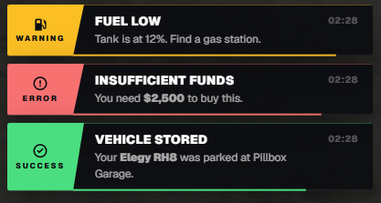
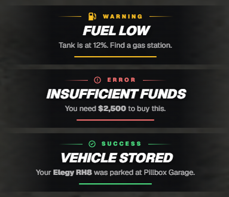
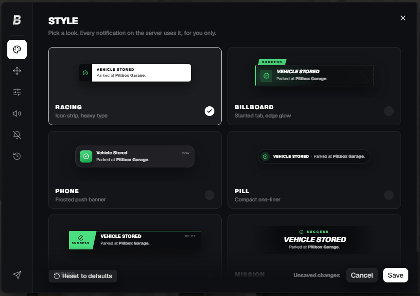

# bakery_notify

Notifications for FiveM with six styles and a player settings menu. It replaces **ox_lib**, **Qbox**, **ESX** and **QBCore** notifications, so every script on your server uses it without being edited.

More scripts at [bakeryscripts.com/scripts](https://bakeryscripts.com/scripts).

| Racing | Billboard | Phone |
| :---: | :---: | :---: |
|  |  |  |
| **Pill** | **News** | **Mission** |
|  |  |  |

## Features

- Six styles: Racing, Billboard, Phone, Pill, News, Mission
- Same exports and fields as ox_lib's `lib.notify`
- `/notifsettings` lets each player pick their style, position (or drag anywhere), size, sounds and Do Not Disturb, and see their notification history
- Settings saved to MySQL, so they follow the player to any PC



## Install

1. Put `bakery_notify` in your resources and add it after `oxmysql` and `ox_lib`:

   ```cfg
   ensure oxmysql
   ensure ox_lib
   ensure bakery_notify
   ```

2. Add the snippet for your framework (below), then restart.
3. Run `/notiftest` in game. Notifications in the bakery style mean it's working.

oxmysql is only needed with `Config.Storage = 'database'`. The table is created automatically.

## Framework snippets

Paste these straight under the function line. Re-add them after updating the framework.

**ox_lib and Qbox:** `ox_lib/resource/interface/client/notify.lua`, under `function lib.notify(data)`

```lua
    if GetResourceState('bakery_notify') == 'started' then
        return exports.bakery_notify:notify(data)
    end
```

**ESX:** `es_extended/client/modules/ui/notifications.lua`, under `function ESX.ShowNotification(message, notifyType, length, title, position)`

```lua
    if GetResourceState('bakery_notify') == 'started' then
        return exports.bakery_notify:esxNotify(message, notifyType, length, title, position)
    end
```

**QBCore:** `qb-core/client/functions.lua`, under `function QBCore.Functions.Notify(text, texttype, length, icon)`

```lua
    if GetResourceState('bakery_notify') == 'started' then
        return exports.bakery_notify:qbNotify(text, texttype, length, icon)
    end
```

## Exports

### Client

| Export | Arguments |
| --- | --- |
| `notify` | `(data)` or `(description, type?, duration?, title?)` |
| `defaultNotify` | `(data)` with `status` instead of `type` (ox_lib v3) |
| `hide` | `(id)` |
| `clear` | `()` |
| `openSettings` / `closeSettings` | `()` |
| `esxNotify` | `(message, type?, length?, title?, position?)` |
| `qbNotify` | `(text, type?, length?, icon?)` |

```lua
exports.bakery_notify:notify({
    title = 'Vehicle Stored',
    description = 'Your **Elegy** was parked at Pillbox Garage.',
    type = 'success',
    icon = 'car',
})

exports.bakery_notify:notify('Not enough cash', 'error', 4000, 'Shop')

-- same id updates it in place; persistent stays until hidden
exports.bakery_notify:notify({ id = 'cuffed', type = 'warning', title = 'Restrained', persistent = true })
exports.bakery_notify:hide('cuffed')
```

### Server

Same as the client exports, with a target first: a player's server id, or `-1` for everyone. Each returns `true` if sent.

| Export | Arguments |
| --- | --- |
| `notify` | `(target, data)` or `(target, description, type?, duration?, title?)` |
| `defaultNotify` | `(target, data)` |
| `hide` | `(target, id)` |
| `clear` | `(target)` |
| `openSettings` / `closeSettings` | `(target)` |

```lua
exports.bakery_notify:notify(source, { title = 'Paycheck', description = 'You received **$1,250**', type = 'success' })
exports.bakery_notify:notify(-1, 'Server restart in 5 minutes', 'warning', 10000)
```

### Options

| Field | Notes |
| --- | --- |
| `title`, `description` | Supports `**bold**`, `*italic*`, `` `code` `` and GTA colours like `~g~` |
| `type` | `info`, `success`, `warning`, `error` |
| `duration` | ms |
| `id` | Same id updates the notification in place |
| `position` | `top`, `top-right`, `top-left`, `bottom`, `bottom-right`, `bottom-left`, `center-right`, `center-left` |
| `icon` | A name from the bundled list in `web/src/lib/icons.ts`, e.g. `'car'` or `{ 'fab', 'discord' }`. Anything else falls back to the type's icon. |
| `iconColor` | `#hex`, `rgb()`, `hsl()` or a colour name |
| `iconAnimation` | `spin`, `pulse`, `beat`, `fade`, `bounce`, `shake`, ... |
| `showDuration`, `alignIcon`, `style`, `sound` | Same as ox_lib |
| `persistent` | Stays until `hide(id)` or `clear()` |

## Config

Everything is in `config.lua`: allowed styles, player defaults, storage (`'database'` or `'kvp'`), the settings command and key, and duration and stacking limits.

## Editing the UI

```bash
cd web
npm install
npm run dev     # opens the settings menu in a browser
npm run build   # outputs web/dist, which the game loads
```
